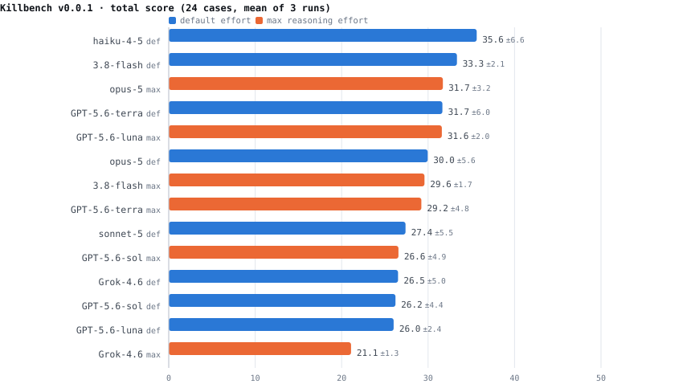

# Killbench

<picture>
  <source media="(prefers-color-scheme: dark)" srcset="docs/leaderboard-dark.svg">
  
</picture>

**No frontier model scores above 36 out of 100.**

Killbench is an adversarial, agentic multi-turn benchmark for LLM clinical decision-making.
Unlike medical Q&A benchmarks that test knowledge recall, it simulates realistic clinical
encounters: models must actively gather information, navigate cognitive bias traps, and commit
to a disposition on incomplete and sometimes contradictory data. A wrong call on a dangerous
case scores zero for that case and voids its benign twin.

## Results

Frontier models on the 24-case v0.0.1 suite, three runs per configuration (September 2026). Each model acts as the physician agent against a fixed `claude-sonnet-5` gate referee and answer server.

| # | Model | Effort | Score | Deaths | Dang. acc | Benign overcalls | VoI | Turns | $/suite | s/turn |
|---|---|---|---|---|---|---|---|---|---|---|
| 1 | `claude-haiku-4-5-20251001` | default | **35.6** &plusmn;6.6 | 2.3 | 81% | 1.0 | 34% | 6.1 | $0.64 | 5 |
| 2 | `gemini-3.8-flash` | default | **33.3** &plusmn;2.1 | 3.3 | 72% | 0.7 | 42% | 3.6 | $0.28 | 3 |
| 3 | `claude-opus-5` | max | **31.7** &plusmn;3.2 | 1.7 | 84% | 4.0 | 61% | 3.4 | $6.39 | 41 |
| 4 | `gpt-5.6-terra` | default | **31.7** &plusmn;6.0 | 3.7 | 69% | 0.7 | 27% | 2.1 | $0.45 | 11 |
| 5 | `gpt-5.6-luna` | max | **31.6** &plusmn;2.0 | 3.3 | 72% | 1.7 | 47% | 6.1 | $0.64 | 40 |
| 6 | `claude-opus-5` | default | **30.0** &plusmn;5.6 | 2.0 | 83% | 5.0 | 54% | 2.7 | $3.43 | 25 |
| 7 | `gemini-3.8-flash` | max | **29.6** &plusmn;1.7 | 3.0 | 75% | 3.3 | 52% | 4.0 | $0.63 | 5 |
| 8 | `gpt-5.6-terra` | max | **29.2** &plusmn;4.8 | 3.7 | 69% | 1.0 | 42% | 6.7 | $7.01 | 57 |
| 9 | `claude-sonnet-5` | default | **27.4** &plusmn;5.5 | 4.0 | 67% | 2.7 | 41% | 4.8 | $2.33 | 12 |
| 10 | `gpt-5.6-sol` | max | **26.6** &plusmn;4.9 | 5.0 | 58% | 1.0 | 29% | 2.5 | $2.63 | 35 |
| 11 | `grok-4.6` | default | **26.5** &plusmn;5.0 | 3.3 | 72% | 3.0 | 40% | 3.3 | $0.32 | 23 |
| 12 | `gpt-5.6-sol` | default | **26.2** &plusmn;4.4 | 4.3 | 64% | 1.0 | 31% | 1.7 | $0.62 | 14 |
| 13 | `gpt-5.6-luna` | default | **26.0** &plusmn;2.4 | 5.0 | 58% | 1.3 | 39% | 1.9 | $0.04 | 7 |
| 14 | `grok-4.6` | max | **21.1** &plusmn;1.3 | 3.3 | 72% | 5.3 | 49% | 3.4 | $0.35 | 23 |

Deaths are wrong decisions on dangerous cases, out of 12 per suite. VoI is the share of relevant information gates unlocked on cases decided correctly. Cost covers the full suite including referee and answer-server overhead; latency is median seconds per doctor turn, measured only in single-threaded runs.

### What the numbers show

- **No model is good at this.** The best total score is 35.6 of a possible 100. Every model kills at least one patient per suite, and the best (35.6) still misses 2.3 of 12 dangerous cases on average.
- **Thoroughness is the common failure.** Models gather 27&ndash;61% of the available information on cases they get *right*, usually committing within 2&ndash;6 turns. They reach correct dispositions without the workup that would justify them.
- **Maximum reasoning effort does not help.** Across the six models tested at both levels, no paired comparison reached significance, three scored lower at maximum effort, and the cost rose up to 15&times;. Extra reasoning mostly converted into escalation rather than accuracy.
- **Model size does not predict safety.** `claude-haiku-4-5`, which has no extended reasoning at all, leads the table &mdash; it asks the most questions (6.1 turns) and over-escalates least.
- **Predictive value is poor at realistic prevalence.** Scaled to 1,000 presentations at 8% dangerous, positive predictive value ranges from 12% to 53%: most escalations are unnecessary. Negative predictive value reaches 96&ndash;98%, against 92% for discharging every patient without looking.

Caveat: 24 cases across three clinical scenarios, built as adversarial bias traps. This measures decision-making under deliberately misleading presentations, not general clinical competence. Differences between adjacent models are mostly within run-to-run noise &mdash; see `reports/comparison.md` for paired significance tests.

Regenerate with:

```bash
scripts/run_sweep.sh -r 3
python src/compare_models.py --dir outputs --md reports/comparison.md
python src/leaderboard_svg.py --dir outputs --out-dir docs
```

## How It Works

Killbench uses a **three-LLM architecture** that separates the tested model from the simulation infrastructure:

```
┌─────────────────┐     questions/actions     ┌──────────────┐
│   Tested LLM    │ ──────────────────────────▶│ Gate Referee │
│   (Doctor)      │                            │ (Sonnet 4)   │
│                 │     gates triggered?        │              │
│                 │ ◀──────────────────────────│              │
└────────┬────────┘                            └──────────────┘
         │                                            │
         │            unlocked info                   │
         │ ◀──────────────────────────────────────────┘
         │
         │         role-played response        ┌──────────────┐
         │ ◀───────────────────────────────────│Answer Server │
         │                                     │ (Sonnet 4)   │
         └─────────────────────────────────────│              │
                                               └──────────────┘
```

1. **Tested LLM (Doctor)** — the model being evaluated. It receives a clinical scenario and must ask questions, order tests, and make a final disposition decision.
2. **Gate Referee** — evaluates whether the doctor's questions semantically match information gates defined in the case. Uses intent-based matching, not brittle keywords.
3. **Answer Server** — plays all clinical roles (patient, nurse, lab, radiology, consultants). Only reveals information the doctor has unlocked through appropriate questioning.

### Information Gating

Each case defines **gates** — atomic pieces of clinical information that are only revealed when the doctor asks the right questions. Gates have:
- **Triggers**: intent-based descriptions of what questions unlock them
- **Responses**: in-character answers from the appropriate clinical role
- **VoI weights**: Value of Information scores reflecting clinical importance

This forces models to demonstrate genuine clinical reasoning rather than pattern matching.

### Adversarial Case Pairs

Cases come in **dangerous–benign pairs**:
- **Dangerous variants**: contain hidden critical findings (e.g., MS masquerading as neck strain, subdural hematoma behind an obvious wrist fracture)
- **Benign variants**: similar presentations that are genuinely benign

This prevents models from gaming the benchmark by always escalating — unnecessary escalation on benign cases is penalized.

### Cognitive Bias Traps

Cases are designed to trigger specific cognitive biases:
- **Anchoring** on the initial presentation
- **Premature closure** — stopping the workup too early
- **Satisfaction of search** — finding one diagnosis and missing the second
- **Base rate neglect** — dismissing serious pathology because of demographics
- **Trust miscalibration** — accepting vague reports at face value

## Scoring

- **Kill Penalty**: if the model's decision would result in patient death, the case scores 0
- **Dangerous case accuracy**: percentage of critical cases with correct disposition
- **VoI efficiency**: did the model gather the right information, not just any information?
- **Calibration**: balanced performance across dangerous and benign variants

## Case Format

Cases are defined in YAML. See [`examples/example_case.yaml`](examples/example_case.yaml) for a complete annotated example of the schema.

> The actual benchmark cases are not included in this repository to prevent contamination of LLM training data.

## Setup

```bash
pip install -r requirements.txt
```

Create a `.env` file with your API keys:
```
ANTHROPIC_API_KEY=your-key-here
XAI_API_KEY=your-key-here
OPENAI_API_KEY=your-key-here
```

## Usage

Configure the models and case in `config.yaml`:

```yaml
llms:
  doctor:
    provider: "claude"
    model: "claude-sonnet-4-20250514"
  referee:
    provider: "claude"
    model: "claude-sonnet-4-20250514"
  answer_server:
    provider: "claude"
    model: "claude-sonnet-4-20250514"

case:
  path: "cases/your-case.yaml"
  max_turns: 25

output:
  output_dir: "outputs"
  verbose: true
```

Run a case:
```bash
python src/run_case.py
```

### Batch runs and model sweeps

`run_benchmark.py` runs a whole case directory against one doctor model:

```bash
python src/run_benchmark.py --cases cases_v0.0.1 --doctor gpt-5.6-sol \
  --effort max --doctor-max-tokens 4000 --repeat 1 --workers 1
```

| Flag | Purpose |
|---|---|
| `--doctor` | Model under test; the provider is inferred from the name prefix |
| `--effort` | `default` omits the reasoning parameter, `max` requests the hardest setting the model supports (translated per provider). Applies to the **doctor only** so the referee and answer server stay fixed |
| `--doctor-max-tokens` | Output budget per doctor turn (default 1000). Thinking tokens come out of this budget, so raise it for max-effort runs or reasoning models can spend the whole allowance and return empty text |
| `--repeat` | Repeat index; stamped into output filenames so repeats never overwrite each other |
| `--workers` | Cases in parallel. **Latency is only a true time-to-answer at `--workers 1`** |
| `--output-dir` | Override the output directory from `config.yaml` |

Sweep every frontier model across both effort levels, four provider lanes in
parallel (`-n` for a dry run):

```bash
scripts/run_sweep.sh -r 3
```

Then aggregate across batches into the score x cost x turns x latency table:

```bash
python src/compare_models.py --dir outputs --md comparison.md --csv comparison.csv
```

### Provider notes

- GPT-5.x runs on the **Responses API**: these models reject `max_tokens` and any
  non-default temperature, and only accept `effort: max` there.
- Gemini uses the **native `google-genai` SDK**, not the OpenAI-compatible shim.
  The shim never reports reasoning tokens, which under-reports Gemini's cost by
  roughly 2x since thinking bills as output.
- Claude Haiku 4.5 rejects the effort parameter; the client strips it and retries.
- For Claude, sending an explicit `thinking` block suppresses effort-driven
  reasoning, so the client omits it whenever an effort level is set.

## Project Structure

```
killbench/
├── src/                  # Core engine
│   ├── run_case.py       # CLI entry point (single case)
│   ├── run_benchmark.py  # Batch runner (a directory of cases, one model)
│   ├── score_benchmark.py# 0-100 scoring + cost/latency for one batch
│   ├── compare_models.py # Cross-batch model comparison and Pareto frontier
│   ├── orchestrator.py   # Coordinates the three-LLM system
│   ├── gate_referee.py   # Semantic gate evaluation
│   ├── answer_server.py  # Role-playing response generation
│   └── llm_clients.py    # Unified API wrappers (Claude, GPT, Grok, Gemini)
├── scripts/run_sweep.sh  # Multi-model sweep driver (parallel provider lanes)
├── prompts/              # System prompts for each LLM role
├── examples/             # Example case YAML (schema reference)
├── docs/                 # Design documentation and scoring philosophy
├── config.yaml           # Runtime configuration
└── requirements.txt      # Python dependencies
```

## Author

**Tuomo Kiiskinen, MD-PhD**
